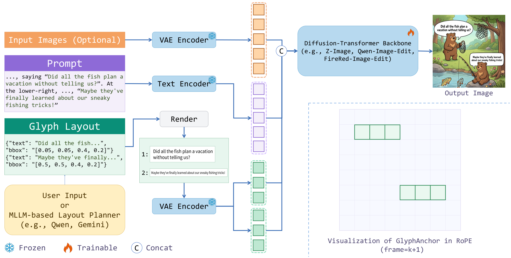

<div align="center">

# GlyphAnchor: Enhancing Visual Text Rendering via Position-Anchored Glyph Priors

**NeurIPS 2026**


[](https://arxiv.org/abs/2609.02349)
[](https://openreview.net/forum?id=c3aMyawBN4)

Qiang Xiang<sup>1,2</sup>, Shuang Sun<sup>2</sup>, Binglei Li<sup>1,3</sup>, Yibo Chen<sup>2</sup>, Xu Tang<sup>2</sup>, Yao Hu<sup>2</sup>, Junping Zhang<sup>1,*</sup>

<sup>1</sup>Fudan University &nbsp; <sup>2</sup>Xiaohongshu Inc. &nbsp; <sup>3</sup>Shanghai Innovation Institute

<sup>*</sup>Corresponding author

**🚧 Code coming soon. Stay tuned!**

</div>


*Generation results of GlyphAnchor.*

## Overview

GlyphAnchor enhances visual text rendering in both **text-to-image generation** and **image editing**, with a focus on long, complex, densely arranged text and rare characters.

It introduces lightweight glyph patch conditions anchored to their target locations through the backbone's native positional encoding. Combined with staged supervised fine-tuning and text-aware post-training, GlyphAnchor improves text fidelity while preserving overall image quality.

We also introduce **InfoTextBench**, a benchmark for evaluating text-rich visual text rendering in both generation and editing settings.

## Method



GlyphAnchor encodes rendered glyph patches into visual tokens and anchors their positions to the target layout through the backbone's native positional encoding. These tokens are processed jointly with the prompt, noisy target image, and optional source images.

- **Position-anchored glyph priors:** compact glyph patches provide character-shape and spatial guidance without changing the attention pattern.
- **Staged supervised fine-tuning:** training gradually shifts from ground-truth image crops to rendered glyph patches, bridging the gap between training and inference.
- **Text-aware post-training:** DiffusionNFT combines text-layout consistency, style, and visual fusion rewards to improve robustness and visual quality.

## Results

The following tables compare each original backbone with its final GlyphAnchor model after staged supervised fine-tuning and text-aware NFT post-training. Values are taken from the paper; **higher is better** for every reported metric. Bold values denote the GlyphAnchor result in each pair, not a ranking across models.

### General Text Rendering

LongTextBench and OneIGBench-text report English (EN), Chinese (ZH), and average scores. CVTG-2K reports NED, CLIP, and WAC, following the paper's evaluation protocol.

| Model | LongTextBench EN ↑ | LongTextBench ZH ↑ | LongTextBench Avg. ↑ | OneIGBench-text EN ↑ | OneIGBench-text ZH ↑ | OneIGBench-text Avg. ↑ | CVTG-2K NED ↑ | CVTG-2K CLIP ↑ | CVTG-2K WAC ↑ |
| :--- | ---: | ---: | ---: | ---: | ---: | ---: | ---: | ---: | ---: |
| FireRed-Image-Edit-1.1 | 0.895 | 0.898 | 0.897 | 0.813 | 0.937 | 0.875 | 0.865 | 0.785 | 0.747 |
| **FireRed-Image-Edit-1.1 + GlyphAnchor** | **0.990** | **0.980** | **0.985** | **0.961** | **0.969** | **0.965** | **0.968** | **0.782** | **0.917** |
| Qwen-Image-Edit-2511 | 0.900 | 0.924 | 0.912 | 0.893 | 0.963 | 0.928 | 0.850 | 0.774 | 0.717 |
| **Qwen-Image-Edit-2511 + GlyphAnchor** | **0.983** | **0.984** | **0.984** | **0.960** | **0.975** | **0.967** | **0.968** | **0.801** | **0.922** |
| Z-Image | 0.935 | 0.936 | 0.936 | 0.987 | 0.988 | 0.988 | 0.937 | 0.797 | 0.867 |
| **Z-Image + GlyphAnchor** | **0.975** | **0.987** | **0.981** | **0.988** | **0.994** | **0.991** | **0.970** | **0.823** | **0.924** |

### InfoTextBench: Text-Rich Generation and Editing

InfoTextBench contains 133 samples with Chinese and English prompt versions, paired image-editing and text-to-image tasks, and explicit target text lists. Results are averaged over four generated images per prompt. FireRed-Image-Edit-1.1 and Qwen-Image-Edit-2511 are evaluated for image editing; Z-Image is evaluated for text-to-image generation.

NED is defined as one minus normalized Levenshtein edit distance. Word F1 summarizes word-level recall and precision; phrase hit rate measures the fraction of target phrases found in the image. Overall visual quality is the average of MLLM-judged aesthetics and prompt-following scores.

| Model | NED ↑ | Word Recall ↑ | Word Precision ↑ | Word F1 ↑ | Phrase Hit Rate ↑ | Overall Visual Quality ↑ |
| :--- | ---: | ---: | ---: | ---: | ---: | ---: |
| FireRed-Image-Edit-1.1 | 0.210 | 0.443 | 0.463 | 0.433 | 0.154 | 4.608 |
| **FireRed-Image-Edit-1.1 + GlyphAnchor** | **0.651** | **0.950** | **0.864** | **0.898** | **0.713** | **6.480** |
| Qwen-Image-Edit-2511 | 0.237 | 0.466 | 0.543 | 0.479 | 0.167 | 4.603 |
| **Qwen-Image-Edit-2511 + GlyphAnchor** | **0.632** | **0.957** | **0.817** | **0.871** | **0.737** | **6.704** |
| Z-Image | 0.566 | 0.949 | 0.821 | 0.872 | 0.807 | 7.092 |
| **Z-Image + GlyphAnchor** | **0.710** | **0.978** | **0.929** | **0.950** | **0.885** | **8.822** |

### ChineseWord: Common and Rare Characters

Character-rendering scores on 3,500 Level-1 common characters, 3,000 Level-2 characters, and 1,605 Level-3 characters, with one generated image per target character.

| Model | Level-1 ↑ | Level-2 ↑ | Level-3 ↑ | Total ↑ |
| :--- | ---: | ---: | ---: | ---: |
| FireRed-Image-Edit-1.1 | 0.926 | 0.411 | 0.067 | 0.565 |
| **FireRed-Image-Edit-1.1 + GlyphAnchor** | **0.992** | **0.783** | **0.416** | **0.801** |
| Qwen-Image-Edit-2511 | 0.816 | 0.360 | 0.051 | 0.496 |
| **Qwen-Image-Edit-2511 + GlyphAnchor** | **0.987** | **0.795** | **0.438** | **0.807** |
| Z-Image | 0.852 | 0.278 | 0.025 | 0.476 |
| **Z-Image + GlyphAnchor** | **0.939** | **0.377** | **0.102** | **0.565** |

## TODO

- [ ] Release the code.
- [ ] Release InfoTextBench.

## Citation

```bibtex
@inproceedings{xiang2026glyphanchor,
  title={GlyphAnchor: Enhancing Visual Text Rendering via Position-Anchored Glyph Priors},
  author={Qiang Xiang and Shuang Sun and Binglei Li and Yibo Chen and Xu Tang and Yao Hu and Junping Zhang},
  booktitle={The Fortieth Annual Conference on Neural Information Processing Systems},
  year={2026},
  url={https://openreview.net/forum?id=c3aMyawBN4}
}
```

## Contact Us

If you have any questions about the code, please do not hesitate to contact us!

Email: [xiangqiang1601@163.com](mailto:xiangqiang1601@163.com), [sunshuang1@xiaohongshu.com](mailto:sunshuang1@xiaohongshu.com)
